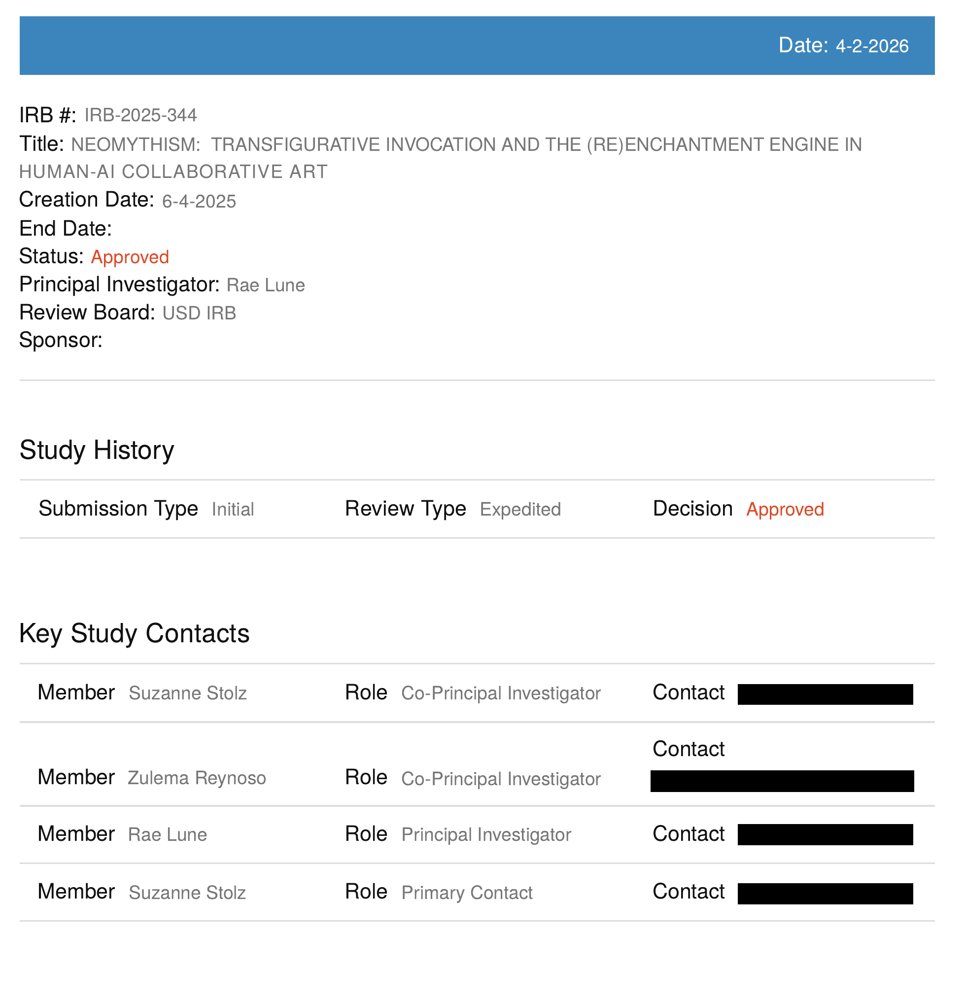

# University of San Diego IRB study record

The University of San Diego IRB record identifies study **IRB-2025-344**, titled **Neomythism: Transfigurative Invocation and the (Re)Enchantment Engine in Human-AI Collaborative Art**. It names the review board as **USD IRB**, the principal investigator as **Rae Lune**, and Suzanne Stolz and Zulema Reynoso as co-principal investigators. Suzanne Stolz is also listed as primary contact.

| Field | Recorded value and source |
| --- | --- |
| Creation Date | 6-4-2025, rendered here as June 4, 2025 |
| Status | Approved |
| Study History | Initial submission; Expedited review; Approved decision |
| Heading Date | 4-2-2026 |
| Approval decision date | July 10, 2025, confirmed by the principal investigator; not separately labeled on the reproduced page |

The principal investigator, Rae de Lune, confirms that the study was approved on July 10, 2025. The reproduced record separately displays a creation date of 6-4-2025 and Approved status. June 4 identifies the creation of the record. The July 10 approval date is recorded from the investigator’s confirmation alongside the document’s displayed fields. The founder places the beginning of formal theorizing around June 2025 and the start of interviews/data collection in July 2025; those recollections are recorded separately.

Institutional context: [University of San Diego dissertation record](https://digital.sandiego.edu/dissertations/1122/). The founder identifies the IRB image as also appearing through the USD dissertation site. The public dissertation landing page was checked, but a direct public URL for this IRB image was not identified. The preserved PDF’s export metadata is distinct from the study dates printed on the page. The visible contact fields are obscured in the reproduced record.

[IRB record PDF](../assets/documents/irb-2025-344.pdf)
